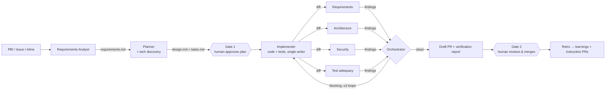

# frontier-delivery

An agentic engineering delivery process, defined as version-controlled markdown, that takes a work item (Azure DevOps PBI, GitHub issue, or inline requirements) through **intake → plan → human approval → implement → verify → draft PR → learn**. It runs today inside existing agent harnesses (Claude Code, GitHub Copilot) and is designed to be promoted, file by file, to an automated pipeline on Azure (Microsoft Agent Framework + Foundry Agent Service) — see [docs/azure-target-architecture.md](docs/azure-target-architecture.md).

## The shape

One orchestrator, spec artifacts as the contract between stages, a single writing agent, and a panel of fresh-context check agents. This follows the pattern production systems converged on in 2025–26 (and avoids the peer role-pipeline failure modes) — the evidence is in [docs/industry-assessment.md](docs/industry-assessment.md).



Two hard human gates: **plan approval** and **PR review**. The process never merges.

## Repo map

| Path | What |
|---|---|
| [process/workflow.md](process/workflow.md) | The delivery state machine: stages, gates, loop budgets, escalation rules |
| [process/handoffs.md](process/handoffs.md) | The inter-agent contracts: handoff envelope schemas + routing table |
| [agents/](agents/) | The 9 harness-neutral role definitions (source of truth) |
| [templates/](templates/) | Artifact templates: requirements (EARS ACs), design, tasks, verification report |
| [.claude/](.claude/) | Claude Code wrappers: `agents/` (8 role subagents) + `commands/deliver.md` (orchestrator entry) |
| [.github/agents/](.github/agents/) | GitHub Copilot wrappers: 9 custom agents (`*.agent.md`) incl. `orchestrator` |
| [adapters/](adapters/) | Adapter docs + the ADO/GitHub MCP tracker mapping (capability → tool table) |
| [docs/](docs/) | Azure target architecture and the industry research this design is based on |

## Quickstart

**In this repo**: the wrappers are already live in `.claude/` and `.github/agents/` — just configure MCP ([adapters/README.md](adapters/README.md)) and run `/deliver …` (Claude Code) or select the `orchestrator` custom agent (Copilot).

**In your product repo**:

```bash
git submodule add <this-repo-url> .frontier
mkdir -p .claude/agents .claude/commands .github/agents
cp .frontier/.claude/agents/*.md        .claude/agents/
cp .frontier/.claude/commands/*.md      .claude/commands/
cp .frontier/.github/agents/*.agent.md  .github/agents/
# configure ADO and/or GitHub MCP — see .frontier/adapters/README.md
```

Then `/deliver gh:owner/repo#42` (or `ado:org/project/1234`, or paste requirements inline). Details: [adapters/claude-code.md](adapters/claude-code.md) · [adapters/github-copilot.md](adapters/github-copilot.md).

## Principles (the short list)

1. **Artifacts are the contract** — agents communicate through `work/<id>/` files and typed envelopes, never each other's chat history.
2. **One writer** — only the Implementer touches source; tests are written in the same loop as the code.
3. **Fresh-context verification** — critics see the diff and the artifacts, not the implementer's reasoning.
4. **Bounded loops, explicit escalation** — verify→fix ≤ 3, then a human gets the smallest unblocking question.
5. **Humans own irreversibility** — plan approval and merge are human decisions, always.
6. **The process improves by PR** — the Retro agent proposes instruction edits; humans review them like code.
