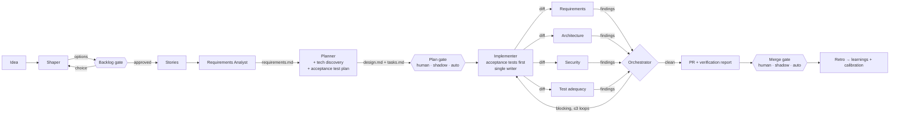

# frontier-delivery

An agentic engineering delivery process, defined as version-controlled markdown, contracts and policy. It takes an **idea → options → backlog → (per story) plan → implement → verify → PR → learn**, with you stepping in only at the decisions that matter.

It runs today in three ways, all sharing the same roles, contracts and policy:

| Mode | You act through | Entry |
|---|---|---|
| **Interactive** (Claude Code plugin) | the conversation | `/frontier-delivery:shape`, `/frontier-delivery:deliver`, `/frontier-delivery:inbox` |
| **GitHub-native** (unattended, in Actions) | labels and issue/PR comments | label `frontier:shape` / `frontier:deliver`; reply `/option`, `/approve`, `/changes`, `/answer`, `/reject` |
| **Headless local** (the runner) | the terminal | `python -m frontier deliver …` |

A fourth mode, running the process as a workflow definition on **Frontier Workflow**, is deliberately deferred until the contracts register (E27) lands; see [runner/README.md](runner/README.md#frontier-workflow-deferred).

## The shape

One orchestrator, spec artifacts as the contract between stages, a single writing agent, a panel of fresh-context check agents, and **gates whose autonomy is earned through evidence**.



- **Gates follow the [policy](policy/policy.yaml).** Each gate is `human`, `shadow` (the gate seals a recommendation, you decide, agreement is recorded) or `auto` (proceeds within risk tiers, only while calibration evidence holds, and closes itself on regression). The shipped default is backlog `human`, plan and merge `shadow`.
- **Agents never merge.** Guard hooks block `gh pr merge`, force pushes and commits to the default branch for every agent. At an `auto` merge gate, deterministic code enables GitHub auto-merge, so branch protection still decides.
- **Contracts are data.** Each handoff envelope is a closed JSON Schema 2020-12 contract with CEL rules for cross-field invariants, pinned by hash ([contracts/](contracts/)).

## Repo map

| Path | What |
|---|---|
| [process/workflow.md](process/workflow.md) · [workflow.yaml](process/workflow.yaml) | The state machine: stages, gates, run modes (prose and data) |
| [process/handoffs.md](process/handoffs.md) | The inter-agent contracts in prose, plus the routing table |
| [contracts/](contracts/) | Envelope contracts (JSON Schema + CEL), hash lock, conformance cases |
| [policy/](policy/) | Default gate policy and its schema (copied to `.frontier/policy.yaml` in product repos) |
| [roles/](roles/) | The 10 harness-neutral role definitions (source of truth) |
| [templates/](templates/) | Artifact templates: backlog, decision log, requirements (EARS), design, tasks, verification report |
| [.claude-plugin/](.claude-plugin/) · [agents/](agents/) · [commands/](commands/) · [hooks/](hooks/) | Claude Code plugin: manifest and marketplace, thin role wrappers, the `shape`/`deliver`/`inbox` commands, the guard hook |
| [.github/agents/](.github/agents/) | GitHub Copilot custom-agent wrappers |
| [runner/](runner/) | The deterministic orchestrator (Python) for headless and GitHub modes, plus the guard hook |
| [.github/workflows/frontier.yml](.github/workflows/frontier.yml) | Reusable workflow for GitHub-native mode |
| [init/](init/) | `frontier-init.sh` installs the process into a product repo |
| [evals/](evals/) | How gate calibration and process evals work |
| [tests/](tests/) | Guard, gates, runner loop, GitHub glue, contract conformance, repo consistency |
| [docs/](docs/) | Azure target architecture and the industry research behind the design |

## Quickstart

**Install into a product repo** (from its root):

```bash
bash ~/repos/frontier-delivery/init/frontier-init.sh --github --labels
```

This writes `.frontier/policy.yaml`, enables the plugin in `.claude/settings.json` (marketplace `frontier`, plugin `frontier-delivery`), and with `--github` adds `.github/workflows/frontier.yml`. The script prints the one-off repo settings GitHub mode needs.

**Interactive:** open Claude Code in the repo, then:

```
/frontier-delivery:shape Users want to export reports
/frontier-delivery:deliver gh:owner/repo#42
/frontier-delivery:inbox
```

**GitHub-native:** label an idea issue `frontier:shape` and choose an option with `/option 1`, or label a story `frontier:deliver`. You'll get a draft PR with the plan to `/approve`. Everything waiting on you carries `frontier:needs-decision`.

**Headless local:**

```bash
pip install -r ~/repos/frontier-delivery/runner/requirements.txt
export PYTHONPATH=~/repos/frontier-delivery/runner
python -m frontier deliver local:csv-export --source "Users need CSV export. AC: …"
python -m frontier decide local-csv-export plan approve
python -m frontier build local-csv-export
```

**Working on this repo:** `claude --plugin-dir .` loads the plugin from your checkout. Run `python -m pytest tests` before opening a PR.

## Principles (the short list)

1. **Artifacts are the contract.** Agents communicate through `work/<id>/` files and typed envelopes, never through each other's chat history.
2. **One writer.** Only the Implementer touches source; the approved acceptance tests are written first.
3. **Fresh-context verification.** Critics see the diff and the artifacts, not the implementer's reasoning.
4. **Bounded loops, explicit escalation.** Verify→fix ≤ 3, then you get the smallest unblocking question.
5. **Autonomy is earned through evidence.** Gates start human or shadow, open only with calibration evidence, and close themselves on regression. Agents never merge.
6. **The process improves by PR.** The Retro agent proposes instruction edits; humans review them like code. Gate policy belongs to its named owner.
