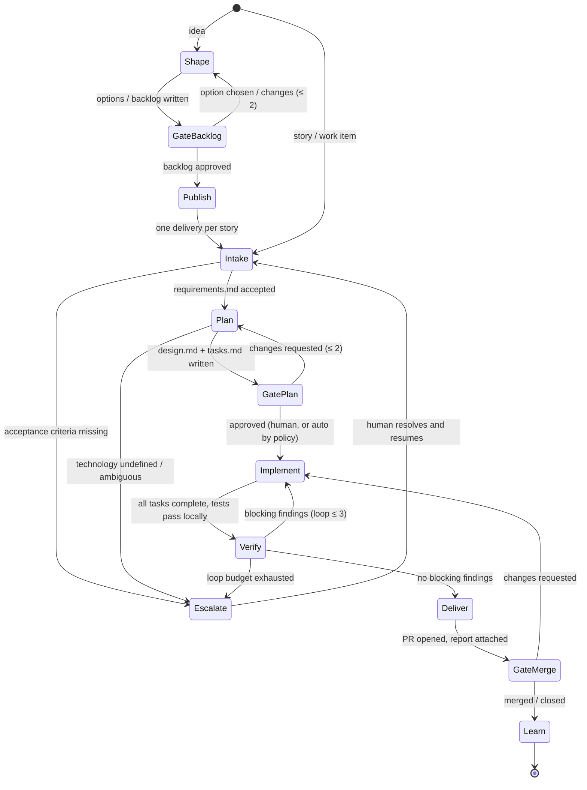

# Delivery Workflow

The end-to-end state machine for frontier delivery, from a rough idea to a merged, learned-from change. The machine-readable form is [workflow.yaml](workflow.yaml); gate behaviour is configured by the [policy](../policy/policy.yaml).

- **Shaping** takes one idea to an approved backlog of stories.
- **Delivery** takes one story (ADO PBI / GitHub issue / inline request) to a reviewed pull request.

## Gate policy

There are three gates: **backlog**, **plan** and **merge**. Each runs in one of three modes, set per gate in the policy:

| Mode | What happens | Who decides |
|---|---|---|
| `human` | Artifacts are presented; the flow waits. | The human. |
| `shadow` | The gate works out a recommendation (`approve` / `changes` / `escalate`) and a risk tier, **seals** it, and waits. After the human decides, the recommendation is revealed and the agreement recorded to the calibration log. | The human. The gate is being calibrated. |
| `auto` | If the recommendation is `approve`, the risk tier is in `auto_when.risk_tiers`, the gate-specific limits hold, and calibration still clears its thresholds, the flow proceeds and the human is notified. Otherwise the gate behaves as `shadow`. | The policy, within evidence-backed limits. |

Rules:
- **Autonomy is earned through evidence.** A gate moves to `auto` only by a PR to the policy approved by its named `owner`, once its calibration records show at least `min_samples` decisions with agreement of at least `min_agreement`.
- **Auto-close on regression.** If, within the last `regression.window` decisions, there are more than `max_false_approvals` cases where the gate recommended `approve` and the human disagreed (or the change was later reverted), the runner treats the gate as `shadow` until the evidence recovers. No PR is needed to close a gate.
- **Sealed recommendations.** In `shadow` mode the human never sees the recommendation before deciding. Otherwise the agreement rate would measure anchoring, not judgment.
- **Agents never merge.** At an `auto` merge gate, the runner (deterministic code, not an agent) enables GitHub auto-merge, so the merge still waits for branch protection: required CI checks and any required reviews. The guard hooks block every agent from `gh pr merge`, `gh pr ready`, force-pushes and pushes to the default branch.

**Risk tiers** are computed deterministically ([runner/frontier/gate.py](../runner/frontier/gate.py)):
- **High**: any planned or changed path matches `risk.protected_paths`, the story carries a `high_risk_flags` flag, the planner chose a technology on the human's say-so (`technology.source: user`), or the change exceeds the medium limits.
- **Medium**: the change exceeds the low limits, or the planner reported risks.
- **Low**: everything else.

## Stages

### 0. Shape: Shaper (optional; starts from an idea)
- Input: an idea issue (label `frontier:shape`), or inline text via `/frontier-delivery:shape`.
- **Options phase**: the Shaper frames the problem and writes 2–3 materially different options to `work/<shape-id>/options.md`, with a recommendation. It returns `needs_input`. The human picks an option at the backlog gate.
- **Backlog phase**: with the chosen option, it writes `backlog.md` and `backlog.yaml` (an epic plus INVEST stories with EARS ACs, ordered from a walking skeleton outwards) and records decisions in `decision-log.md`.
- **Gate: backlog.** On approval, each story is published as a tracker issue in the shape the Requirements Analyst accepts unchanged. With `backlog.auto_start`, stories with no unmet dependencies start delivery straight away.

### 1. Intake: Requirements Analyst
- Input: a work-item reference (`ado:<org>/<project>/<id>` or `gh:<owner>/<repo>#<n>`) **or** requirements given directly.
- The analyst writes `work/<id>/requirements.md` from [templates/requirements.md](../templates/requirements.md).
- **Rejection rule**: if no acceptance criteria can be extracted, the analyst does not invent them. It returns `status: needs_input` and the orchestrator escalates with the specific gaps.

### 2. Plan: Planner
- Reads `requirements.md` plus the target repository.
- **Technology discovery** first: detect the stack from the repo. If the repo is empty or the stack is ambiguous, return `needs_input` with options. The planner never picks a stack for a greenfield repo on its own.
- Writes `work/<id>/design.md` (including the **Acceptance test plan** and **Planned paths**) and `work/<id>/tasks.md`, where `T1` is always "write the acceptance tests, failing".

### 3. Gate: plan
- The orchestrator presents `requirements.md`, `design.md` and `tasks.md`. Review the acceptance test plan above everything else: it is the executable definition of done.
- Requested changes go back to the Planner verbatim (≤ 2 cycles, then escalate).

### 4. Implement: Implementer
- Works on `delivery/<id>`, ideally in an isolated worktree or container.
- `T1` commits the approved acceptance tests (failing) before any production code. Then it executes the remaining tasks, writing code and unit tests in the same loop.
- Definition of done: every task checked, full suite passing, and a self-check against each AC recorded in the handoff.
- **Single-writer rule**: only the Implementer modifies source. The guard hooks enforce this for the other roles.

### 5. Verify: Check Panel
- Four fresh-context check agents run **in parallel**, each seeing only the diff plus the `work/<id>/` artifacts: `check-requirements`, `check-architecture`, `check-security` and `check-test-adequacy`. The test-adequacy check also confirms the approved acceptance tests are intact.
- Findings are merged into `work/<id>/verification-report.md`.
- **Fix loop**: `blocking` findings go back to the Implementer verbatim. At most `budgets.verify_fix` (default 3) iterations, then escalate.
- `advisory` findings never block; they are carried into the PR description.

### 6. Deliver
- The PR is linked to the work item, with the verification report and the AC self-check in its description.
- **Gate: merge.** In `human` and `shadow` modes you review and merge (or comment `/changes …`, which re-enters Implement with your comments as findings). In `auto`, the runner enables auto-merge under branch protection.

### 7. Learn: Retro
- Runs after merge or close. It compares plan vs outcome, check findings vs what humans still caught, gate recommendations vs human decisions, and loop counts.
- Appends to `learnings.md` and proposes instruction edits as PRs. It never proposes gate-mode or threshold changes; those belong to the policy owner.

## Run modes

The same roles, contracts and policy run in three modes:

| Mode | Orchestrator | Where the human acts | Entry |
|---|---|---|---|
| **Interactive** | The Claude Code main session, following [roles/orchestrator.md](../roles/orchestrator.md) | In the conversation | `/frontier-delivery:shape`, `/frontier-delivery:deliver` |
| **GitHub-native** (unattended) | The deterministic runner, in GitHub Actions | Issue/PR comments: `/option`, `/approve`, `/changes`, `/answer`, `/reject` | Labels `frontier:shape`, `frontier:deliver` |
| **Headless local / cloud** | The same runner, from a terminal; later Frontier Workflow on Azure | The runner's gate files, or the tracker | `python -m frontier …` (see [runner/README.md](../runner/README.md)) |

## Global rules (all stages)

- **Artifacts are the contract.** Agents communicate only through `work/<id>/` files and the handoff envelopes in [handoffs.md](handoffs.md). No agent relies on another agent's chat history.
- **Full artifacts, never summaries of summaries.** Findings and comments are routed verbatim.
- **Bounded loops everywhere.** Verify→fix, re-plan and re-shape budgets come from the policy. Any agent may return `needs_input`; only the orchestrator talks to the human.
- **Escalation shape**: what was attempted, what is blocking, and the smallest question that unblocks it (with options where possible).
- **One inbox.** Everything waiting on a human carries the `frontier:needs-decision` label (GitHub mode) or appears in `/frontier-delivery:inbox`.
- **Cost guardrail**: if a delivery exceeds its loop budgets it stops and escalates rather than grinding on.
