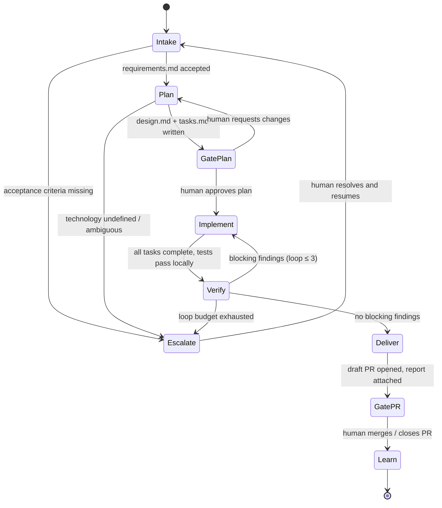

# Delivery Workflow

The end-to-end state machine the **Delivery Orchestrator** runs for every piece of work.
One delivery = one work item (ADO PBI / GitHub issue / inline user request) taken from intake to a reviewed pull request.

## Stages

### 1. Intake — Requirements Analyst
- Input: a work-item reference (`ado:<org>/<project>/<id>` or `gh:<owner>/<repo>#<n>`) **or** requirements pasted directly by the user.
- The analyst fetches the work item via the tracker MCP tools (see [adapters/README.md](../adapters/README.md)) and writes `work/<id>/requirements.md` from [templates/requirements.md](../templates/requirements.md).
- **Rejection rule**: if no acceptance criteria can be extracted from the work item or the user input, the analyst does not invent them — it returns `status: needs_input` and the orchestrator escalates to the human with the specific gaps listed.

### 2. Plan — Planner
- Reads `requirements.md` plus the target repository.
- **Technology discovery step** (absorbed from the original Technology-agent role): detect the stack from the repo (manifests, lockfiles, CI config, existing conventions). If the repo is empty or the stack is ambiguous/conflicting, return `status: needs_input` with concrete options — the orchestrator prompts the human for the technology choice. The planner never picks a stack for a greenfield repo on its own.
- Writes `work/<id>/design.md` and `work/<id>/tasks.md`.

### 3. Gate: Plan approval (human) — HARD GATE
- The orchestrator presents `requirements.md`, `design.md`, and `tasks.md` to the human.
- No implementation starts before explicit approval. Requested changes go back to the Planner with the human's comments verbatim.

### 4. Implement — Implementer
- Works on a dedicated branch (`delivery/<id>`), ideally in an isolated worktree/sandbox.
- Executes `tasks.md` in order, writing production code **and** its unit/functional tests in the same loop. Ticks tasks off in `tasks.md` as it goes.
- Definition of done for this stage: every task checked, the full test suite passes locally, and a self-check against each acceptance criterion is recorded in its handoff output.
- **Single-writer rule**: only the Implementer modifies source code. Check agents read; the orchestrator routes; nobody else writes.

### 5. Verify — Check Panel
- Four fresh-context check agents run **in parallel**, each seeing the diff + the `work/<id>/` artifacts but none of the Implementer's conversation:
  - `check-requirements` — does the change satisfy every acceptance criterion?
  - `check-architecture` — design/pattern/best-practice review against `design.md` and repo conventions.
  - `check-security` — security review of the introduced/changed code.
  - `check-test-adequacy` — do the tests actually cover the acceptance criteria and failure paths?
- Each returns structured findings per [handoffs.md](handoffs.md). The orchestrator merges them into `work/<id>/verification-report.md`.
- **Fix loop**: `blocking` findings go back to the Implementer *with the findings verbatim* (never summarized). Maximum **3** verify→fix iterations; on the 3rd failure the orchestrator escalates to the human with the outstanding findings.
- `advisory` findings never block; they are carried into the PR description.

### 6. Deliver
- Orchestrator (via Implementer's branch) opens a **draft PR** linked to the work item, with the verification report and the AC self-check in the description.
- **Gate: PR review (human) — HARD GATE.** The process never merges. Human review comments that require changes re-enter the flow at Implement (small) or Plan (scope change).

### 7. Learn — Retro agent
- Runs after merge/close. Compares: the plan vs what was actually built, check findings vs what humans still caught in PR review, and the number of fix loops used.
- Appends dated entries to `learnings.md` and, where a lesson maps to a specific agent's instructions, proposes the instruction-file edit as a PR against this repo. Humans review those PRs like any other.

## Global rules (all stages)

- **Artifacts are the contract.** Agents communicate only through the files in `work/<id>/` and the structured handoff envelopes in [handoffs.md](handoffs.md). No agent relies on another agent's chat history.
- **Full artifacts, never summaries of summaries.** When the orchestrator routes findings or comments, it passes them verbatim.
- **Bounded loops everywhere.** Verify→fix ≤ 3. Plan re-approval ≤ 2 before escalation. Any agent may return `needs_input` at any time; the orchestrator is the only component that talks to the human.
- **Escalation shape**: what was attempted, what is blocking, the smallest question that unblocks (with options where possible).
- **Cost guardrail**: the orchestrator records per-stage effort in its state; if a delivery exceeds its loop budgets it stops and escalates rather than grinding.
